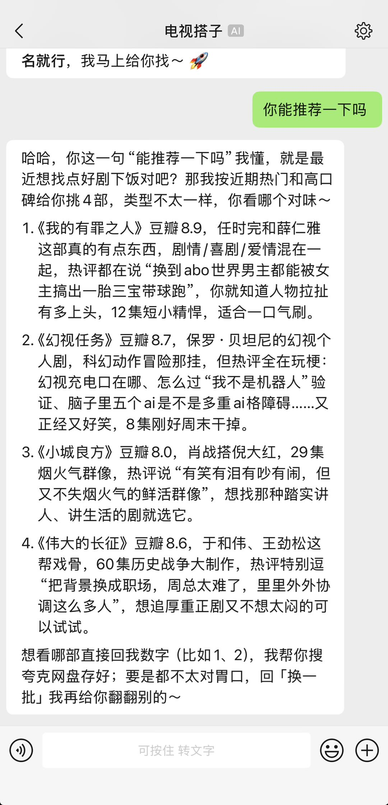
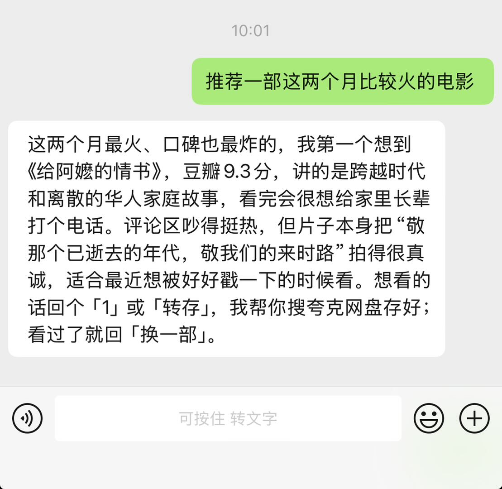
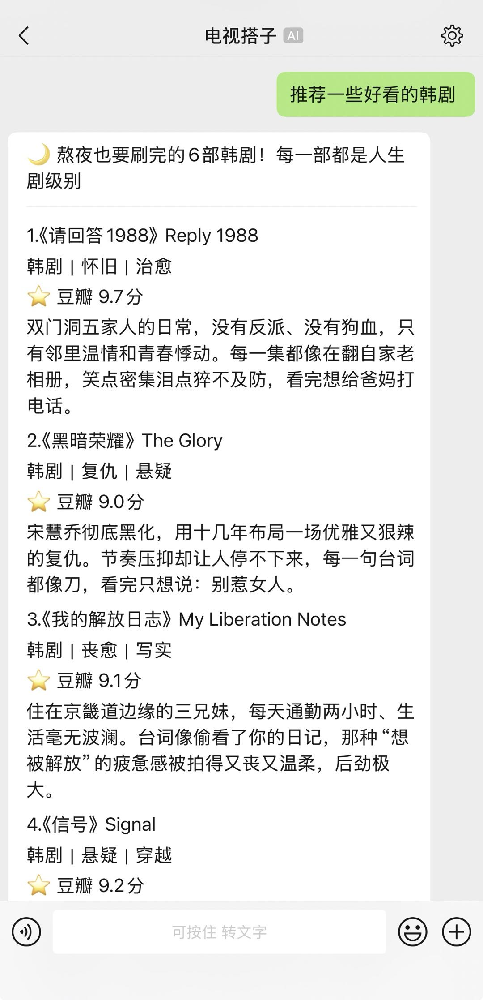
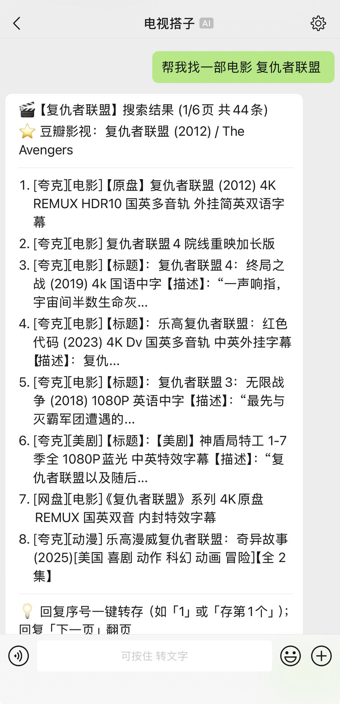
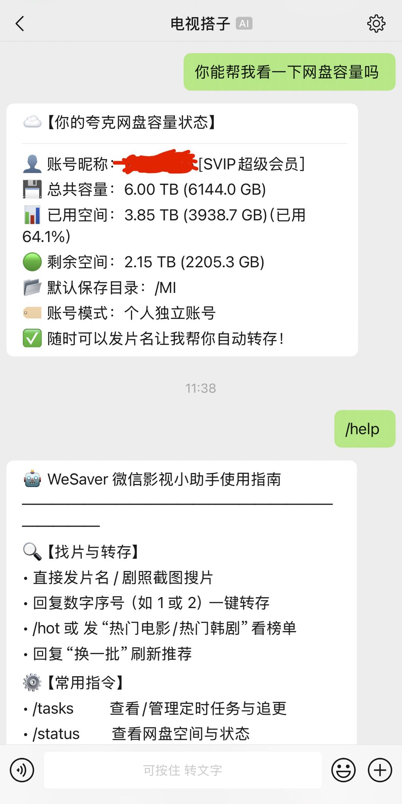

# TVdazi（电视搭子）- 微信端 AI 影视云盘与社交追剧助手

<p align="center">
  
  
  
  
  
  
</p>

**TVdazi（中文名：电视搭子）** 是一款基于 **Node.js + TypeScript + DeepSeek 大模型** 驱动的微信端个人智能影视云盘与社交追剧助手。系统原生接入微信通道（零 Hook、免逆向），聚合全网 **50+ 公开资源频道**，集成了**小红书风格种草、看图识片、多网盘自动转存、Emby 媒体库规范整理、全自动追更监控、H5 控制面板**以及**多微信用户隔空传话**等完整能力，像一位懂片、靠谱的微信好友一样陪你和朋友一起看剧。

> [!NOTE]
> **项目渊源与致谢 (Lineage & Acknowledgements)**  
> 本项目由 [FeishuSaver](https://github.com/Level6me/FeishuSaver)（飞书云盘转存助手）架构重构演进而来，而 FeishuSaver 的核心搜存理念最初源于开源项目 [cloudsaver](https://github.com/cloudsaver) 生态。  
> **TVdazi（电视搭子）** 在继承前作搜存底座的同时，全面转向微信原生多账号生态，重构了多用户隔离、好友裂变、H5 控制台、跨用户传话与媒体库治理体系。在此向所有前作及开源社区的探索精神致以崇高敬意！

---

## 📸 运行效果展示

<p align="center">
  
  
  
</p>

<p align="center">
  
  
</p>

---

## 🌟 核心能力全景

### 1. 全网 50+ 源三语并发搜存 & 频道动态熔断
* **国内直连免魔法**：内置 50+ 高活跃度公开共享频道，支持中文片名 + 原语言片名 + 英文译名共享并发池联合检索。
* **智能健康度调度**：内置 `ChannelHealthService` 实时追踪各频道延迟、成功率与命中率；连续失败 3 次自动熔断 5 分钟，并支持 `/channels-health` 查看实时看板。
* **高频热词缓存**：基于带 TTL 的 LRU 缓存，热门片名秒级响应并按用户当前画质偏好实时重排。

### 2. AI 题材语义扩片、看图识片与小红书种草
* **题材语义扩片 + 豆瓣核验**：发“来一部狙击手题材的电影”“有没有讲潜艇战的片子”，自动扩展经典代表作并经豆瓣核验，告别字面僵硬匹配。
* **多模态海报/剧照识片**：直接发送截图或外语海报，结合豆瓣 / Bangumi / TMDB 自动对齐正式中文译名并询问搜片。
* **俗称纠错**：自动将“荷兰弟蜘蛛侠”“甜茶沙丘”“小李子盗梦空间”等口语纠偏为标准片名。

### 3. 画质结构化优选 & 外挂字幕检索
* **结构化打分与标签展示**：自动识别 `4K`、`杜比视界`、`HDR`、`原盘/REMUX`、`高码率`、`国粤双语`、`特效中字` 及文件体积。
* **自然语言偏好**：支持 `/prefer 4K杜比`、`/prefer 体积小1080P` 等任意自然语言画质偏好设置。
* **外挂字幕专搜**：发送 `/subtitle <片名>` 专项匹配 `.srt` / `.ass` / 特效字幕资源。

### 4. 网盘防和谐清洗、Emby 标准命名 & 空间去重
* **智能防和谐洗白**：转存时或发送 `/clean-names` 自动将 `J 妗兲湜忲陽雨` 等混淆文件名规整为标准片名，完整保留集数、画质与扩展名。
* **Emby / Infuse / VidHub 规范整理**：支持 `/organize preview` 与 `/organize`，自动把杂乱剧集文件规范为 `剧名 (年份) - S01E01.mkv`。
* **重复资源治理**：支持 `/dedup`（只读预览）与 `/dedup-clean`（自动保留 4K/REMUX 最高画质，清理低清冗余副本释放空间）。

### 5. 多网盘聚合适配 & Alist / Emby 扫库联动
* **统一网盘接口**：除默认**夸克网盘**外，已抽象 `CloudDriveProvider` 并适配**阿里云盘**（`/set-aliyun`）与 **115 网盘**（`/set-115`），选中对应分享链接即可一键直存。
* **媒体库 Webhook**：通过 `/set-webhook <URL>` 配置 Alist / Emby / Jellyfin 回调，资源入库后异步推送通知触发扫库刷新（支持 HMAC-SHA256 签名）。

### 6. 全场景智能定时、延时与追更引擎
* 支持自然语言创建相对延时、定点定时与周期巡检任务：
  * **延时任务**：`两分钟后推荐一部电影`、`半小时后转存到网盘`
  * **定时荐片**：`每天早上8点推一部科幻电影`
  * **新片蹲守 & 连载追更**：`《流浪地球3》有资源了通知我`、`每15分钟追更《庆余年》`
  * **4K 洗版 & 网盘守护**：`等《奥本海默》出4K了存一下`、`开启全套智能守护`

### 7. 多用户隔空传话与通讯录系统
* **自动感知活跃微信用户**：自动记录通过 Bot 接入的微信用户，支持查看人数与序号（`/users` / `通讯录`）。
* **昵称与备注记忆**：发 `我叫小明` 或 `/name 小明` 记住对外称呼；发 `/alias 2 小红` 为他人设置本地备注。
* **自然语言接力传话**：A 对机器人说 *“你问一下小红最近有什么好看的电影”*，机器人主动向 B 带话；B 回复 *“你跟他说最近《周处除三害》不错”*，机器人自动回传给 A，支持免打扰（`/dnd on|off`）。

### 8. 轻量 H5 可视化控制面板（支持自定义域名）
* 在微信发送 `/web` 或 `/panel`，签发 15 分钟有效 HMAC 签名链接，手机直接打开管理：
  * **自定义域名 / 访问前缀**：在线设置 `PUBLIC_BASE_URL` 并持久化到 `.env`，留空自动探测公网 IP。
  * **网盘凭证绑定**：可视化填写夸克 Cookie、阿里云盘 Token、115 Cookie、Webhook 与个人昵称。
  * **片单批量导入 & 任务看板**：支持粘贴豆瓣豆列 URL 或含 `《片名》` 的小红书文案批量导入片单，实时开关定时任务与查看频道健康度 Top 20。

---

## 🚀 一键极速部署 (推荐)

在 Linux 云服务器或 NAS 终端运行：

```bash
bash <(curl -fsSL https://raw.githubusercontent.com/Level6me/TVdazi/main/install.sh)
```

脚本全自动完成：
1. 检查并安装 Node.js 18+、Git、PM2 等运行环境；
2. 交互式引导配置 DeepSeek Key、夸克 Cookie、保存目录、服务端口与 **Web 面板访问域名/端口**（重跑会保留已有扩展配置）；
3. 安装依赖、执行 `npm run build` 编译打包并启动 `tvdazi-wechat` PM2 守护进程；
4. 终端打印微信扫码授权二维码，扫码即可上线使用。

---

## 📦 手动部署与 Docker 运行

### 手动部署

```bash
git clone https://github.com/Level6me/TVdazi.git
cd TVdazi
npm install
cp .env.example .env
# 编辑 .env 填入 DEEPSEEK_API_KEY 等配置
npm test        # 编译并运行全部核心单元测试
pm2 start ecosystem.config.js
pm2 save
pm2 logs tvdazi-wechat
```

### Docker Compose 部署

```bash
docker compose up -d --build
docker logs -f tvdazi
```

---

## 💬 微信常用指令与口语速查

| 场景 | 自然语言示例 | 快捷指令 |
| :--- | :--- | :--- |
| **找片与转存** | `想看周星驰功夫` / 回复 `1` | `/search <片名>` / `1` ~ `N` |
| **看图识片** | 直接发送海报、剧照截图 | 发送图片即可 |
| **种草推荐** | `推荐一部高分悬疑电影` / `换一部` | `/hot` / `/热门` |
| **画质与字幕** | `设置画质偏好` | `/prefer 4K杜比` · `/subtitle <片名>` |
| **网盘整理去重** | `帮我清理网盘防和谐名字` | `/clean-names` · `/organize` · `/dedup` |
| **片单批量导入** | `查看片单` | `/追剧` · `/import-list <豆瓣URL或文案>` |
| **定时与追更** | `半小时后推部电影` / `蹲守《片名》` | `/tasks` · `/task-interval 1 10` |
| **多用户传话** | `我叫小明` / `你问下小红最近看啥剧` / `跟他说...` | `/users` · `/name` · `/alias` · `/say` · `/reply` · `/dnd` |
| **H5 控制面板** | `打开控制台` | `/web` 或 `/panel` |
| **好友分享裂变** | `把你推荐给朋友` | `/share` |
| **多网盘与配置** | `网盘还有多少空间` | `/status` · `/config` · `/set-quark` · `/set-aliyun` · `/set-115` · `/set-webhook` |

---

## 📁 目录架构

```text
TVdazi/
├── src/
│   ├── agent/                  # DeepSeekAgent：自然语言意图大脑、识图与工具编排
│   ├── commands/               # CommandHandler & ExtendedCommands：指令路由与扩展处理器
│   ├── services/
│   │   ├── pan/                # 多网盘抽象层 (Quark / Aliyun / 115)
│   │   ├── scheduler/          # ScheduleTimeParser：自然语言定时/延时解析器
│   │   ├── AiRecommender.ts    # 小红书种草推荐与语义扩片引擎
│   │   ├── AntiCensorService.ts# 防和谐剧名混淆识别与还原
│   │   ├── ChannelHealthService.ts # 50+ 频道健康度追踪与动态熔断器
│   │   ├── MetadataResolver.ts # TMDB / 豆瓣 / Bangumi 跨语种片名对齐与 AI 精筛
│   │   ├── PushGateway.ts      # 全局主动推送网关
│   │   ├── QualityTagger.ts    # 画质/HDR/编码/字幕/体积结构化提取与偏好打分
│   │   ├── QuarkOrganizer.ts   # Emby/Infuse 标准重命名与重复资源识别
│   │   ├── QuarkService.ts     # 夸克网盘 API 封装与目录治理
│   │   ├── RelayService.ts     # 多微信用户通讯录与跨用户接力传话引擎
│   │   ├── SchedulerService.ts # 8 大场景定时推送与轮询监控调度中枢
│   │   ├── Searcher.ts         # 50+ 频道三语联合检索、LRU 缓存与字幕检索
│   │   ├── UserManager.ts      # 多用户隔离配置与邀请继承管理
│   │   ├── WatchlistService.ts # 豆瓣片单链接与多行片名批量解析
│   │   └── WebhookService.ts   # Alist / Emby / Jellyfin 扫库通知 Webhook
│   ├── utils/                  # FileUtils / Logger(统一脱敏) / LruCache / StorageQueue
│   ├── web/                    # DashboardServer：HMAC 鉴权 H5 控制台与域名在线管理
│   ├── wechat/                 # WeixinBot：微信 iLink 多账号长轮询与 CDN 图文收发
│   ├── tests/                  # Node 原生单元测试与 API 集成测试
│   ├── index.ts                # HTTP / 微信公众号 XML 接入网关
│   └── login.ts                # 个人微信通道主启动入口
├── install.sh                  # 一键交互式部署脚本（含 Web 域名向导）
├── ecosystem.config.js         # PM2 守护进程配置 (tvdazi-wechat)
├── Dockerfile & docker-compose.yml
└── README.md
```

---

## ⚠️ 免责声明 (Disclaimer)

1. 本项目仅供编程学习、技术研究与个人日常归档使用，严禁用于任何商业用途或非法传播。
2. 项目检索的所有资源均来自互联网公开分享频道，系统本身不存储、不制作、不上传任何音视频文件。
3. 请严格遵守当地法律法规，支持正版影视作品。

---

## 📄 开源许可证

本项目基于 [MIT License](LICENSE) 开源发布。欢迎提交 PR、Issue 或 Star 支持！
